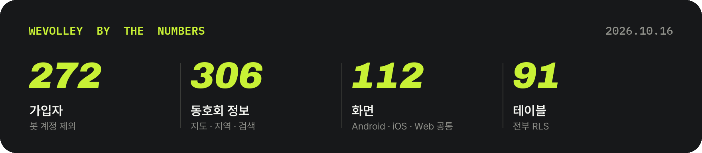
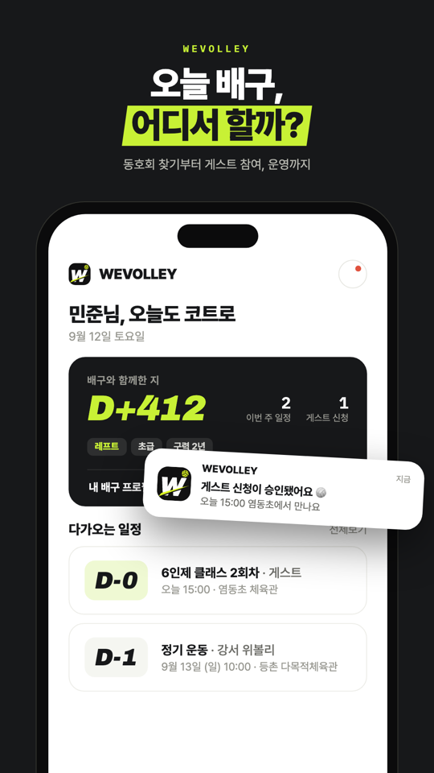
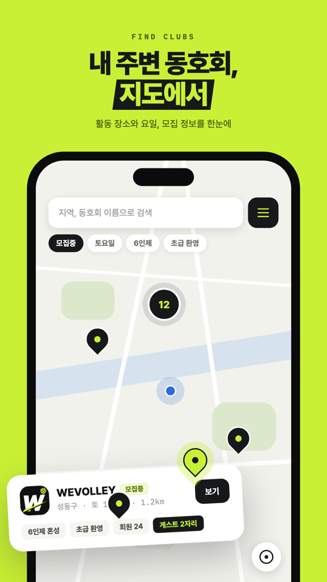
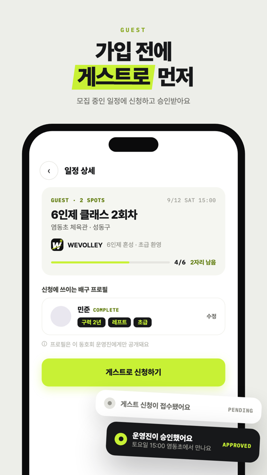
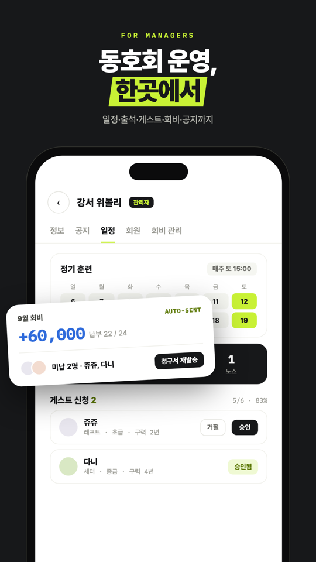
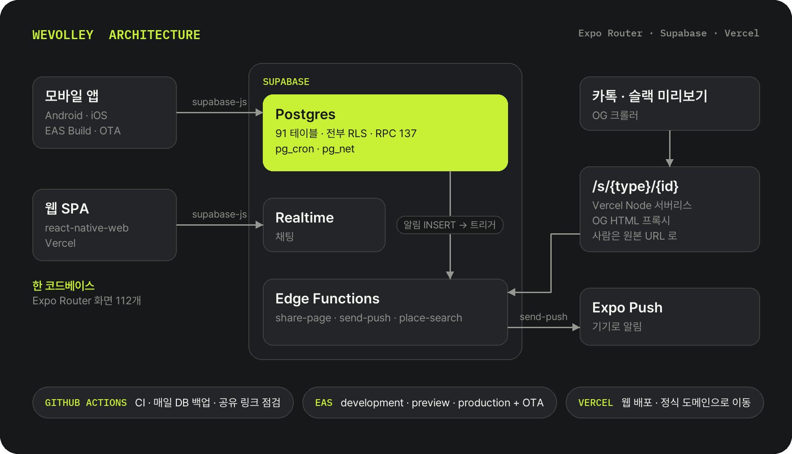

  

  

<h1 align="center">WeVolley 위볼리</h1>

  배구 동호회 찾기부터 게스트 참여, 동호회 운영까지. 
  기획 · 디자인 · 개발 · 배포 · 운영을 한 사람이 하는 멀티플랫폼 앱

  
  
  

  
  
  
  
  
  

> 소개용 저장소다. 앱 코드는 비공개 저장소에 있다.

  

## 화면

  
  
  
  

## 하는 일

- **찾기**: 지도 · 지역 · 이름으로 동호회와 모집 중인 일정, 공공 · 학교 체육관 정보
- **게스트**: 가입 전에 게스트로 신청하고 운영진이 승인
- **동호회 운영**: 일정과 참석 투표, 회원, 회비 장부, 후기
- **소통**: 동호회 채팅, 커뮤니티, 알림
- **공유**: 동호회 · 일정 링크를 로그인 없이 열고, 카톡 · 슬랙에 미리보기
- **운영 도구**: 신고 처리, 사용자 관리

## 아키텍처

  

## 엔지니어링

### 한 코드로 Android · iOS · 웹

- Expo Router 화면 112개를 세 플랫폼이 함께 쓴다. 웹은 react-native-web 으로 그린다.
- 지도 같은 네이티브 전용 모듈은 `*.native.tsx` / `*.web.tsx` 파일로 나눈다.
- 웹에서만 확인하면 놓치는 함정을 규칙으로 만들었다. NativeWind 네이티브 런타임이 함수형 `style` 을 빈 객체로 바꿔 버린 실제 사고 뒤에는 ESLint 규칙과 테스트로 막는다. `Alert.alert` 는 웹에서 아무것도 띄우지 않아 금지하고 확인 모달과 토스트로 바꿨다.

### 로그인 없이 열리는 공유 링크

- 미리보기용 OG 엔트리(`/s/{type}/{id}`)와 원본 URL(`/club/{id}` 등)을 나눴다.
- OG 엔트리는 Vercel Node 서버리스가 Supabase Edge Function(`share-page`)을 프록시한다. Supabase 게이트웨이가 `text/html` 을 `text/plain` 으로 바꿔 보내서, 프록시가 같은 본문을 `text/html` 로 다시 싣는다.
- 크롤러가 아니면 원본 URL 로 보내고, 원본은 SPA 가 로그인 없이 게스트 화면으로 그린다. Android 는 `intent://` 로 앱이나 스토어를, iOS 는 유니버설 링크로 앱을 연다.
- 공유 링크 4종의 연결을 배포 직후와 매주 자동으로 점검한다(GitHub Actions, 읽기 전용).

### 데이터 계층 규칙을 코드로 강제

- 화면은 조합만 하고, 조회와 변경은 도메인 훅이 맡는다. 쿼리 키는 팩토리 한 곳에서만 만든다.
- 모든 쿼리는 실패했을 때를 분류한다. 화면의 주 행동을 막으면 critical(다시 시도 화면), 보조 정보면 degrade-ok(이유 주석 필수). 스크립트가 빠진 곳을 찾는다.
- 변경은 낙관적으로 먼저 반영하고 실패하면 되돌린다. 쿼리 캐시는 AsyncStorage 에 저장해 다시 열면 마지막 화면부터 보인다.

### 규칙은 Postgres 가 지킨다

- 테이블 91개 모두 RLS 를 켰다. 정지된 사용자는 쓰기가 막힌다. 권한이 엮인 작업은 `SECURITY DEFINER` RPC 로 한다.
- 마이그레이션 419개. prod 에 올라간 파일은 sha256 으로 잠가서, 고치거나 사이에 새 파일을 끼우면 테스트가 실패한다.
- 함수를 다시 정의하는 마이그레이션은 직전 정의의 본문 줄과 `SECURITY DEFINER` · `SET` 이 다 남았는지 테스트가 검사한다. 일부러 뺀 줄은 이유를 남겨야 통과한다.

### 알림

- `notifications` INSERT → 트리거 → Edge Function `send-push` → Expo Push.
- 저장할 필요가 없는 알림은 DB 를 거치지 않고 `pg_net` 으로 바로 보낸다. 정기 작업은 `pg_cron`.

### 릴리스

- 네이티브는 EAS 3채널(development · preview · production).
- JS 만 바뀐 배포는 OTA 스크립트 하나로 한다. 네이티브 변경, prod 에 아직 안 올라간 마이그레이션, 로컬 URL 이 번들에 섞이는 경우를 감지하면 멈춘다.
- 웹은 Vercel. `*.vercel.app` 으로 들어오면 정식 도메인으로 보낸다.
- DB 는 매일 덤프를 암호화해 따로 보관한다(GitHub Actions).

### 품질 게이트

- 커밋 전: 바뀐 파일 ESLint + 전체 타입 검사. 타입 에러가 있으면 커밋이 안 된다.
- CI: lint → typecheck → Jest(테스트 파일 306개).
- lint 경고 총량을 21로 동결했다. 새 경고를 들이려면 기존 경고를 먼저 갚고 한도를 내린다(되돌아가지 않는 래칫).

## 기술 스택

- **앱**: Expo SDK 55 · Expo Router(typed routes) · React Native 0.83 · React 19 · TypeScript 5.9 · NativeWind 4 · Reanimated 4 · FlashList 2
- **데이터**: TanStack Query 5(AsyncStorage 캐시 영속화) · supabase-js
- **백엔드**: Supabase: Postgres · RLS · RPC · Realtime · Storage · Edge Functions(Deno) · pg_cron · pg_net
- **배포**: EAS Build · EAS Update(OTA) · Vercel(SPA + Node 서버리스)
- **품질**: ESLint · Prettier · Jest · Husky + lint-staged · GitHub Actions

## 관련

- [WeavePlay](https://github.com/hadan-HwH/weaveplay): 배구 경기 영상에서 공 궤적 · 접촉 · 랠리를 찾는 비전 파이프라인 기록

숫자는 2026-10-16 기준(가입자는 봇 계정 제외). 숫자 카드와 아키텍처 그림은 `tools/` 의 스크립트로 다시 그린다.
